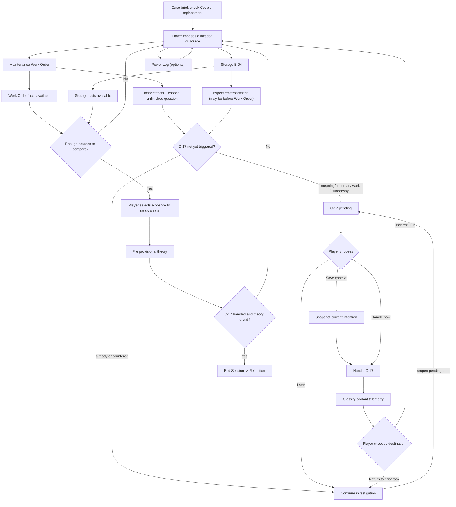

# VOID-EAGER — Loop 1 Final Gameplay Design / Implementation Contract

**Version:** Design Lock 1.0 — 29 October 2026
**Status:** DESIGN LOCK FOR NEXT IMPLEMENTATION / **NOT YET IMPLEMENTED**
**Language:** English technical specification with Thai design framing; in-game UI copy in English. A complete Thai decision summary is provided alongside this file.
**Playable scope:** Coupler Loop 1 only, estimated 5–10 minutes (target, not a measured result)
**Source-of-truth order:** (1) current one-loop scope and latest player feedback; (2) docs/01, 02, 03, 07, 08, 11, 17, 20 and the existing game code; (3) historical full-game canon only where consistent with this slice.
**Explicitly deferred:** opening character conversation, additional crew dialogue, the 6-room case, the old-coupler subplot, new mysteries, AI, new assets.

> **Core promise:** “ฉันกำลังตรวจข้อสงสัยที่ยังไม่เสร็จ — มีงานระบบเข้ามาขัด — ฉันเลือกว่าจะรักษาบริบทอย่างไร — แล้วกลับไปค้นพบความจริงด้วยตัวเอง”

This document is the *proposed behavior to implement next*. It intentionally distinguishes **CURRENT** from **TARGET**, because the code currently differs on several critical mechanics. Do not describe a TARGET feature as already playable. No source code is modified as part of this design lock.

---

## 1. Design decision / สิ่งที่ล็อกแล้ว

1. **One coherent investigation, not a full mystery.** The case asks only whether the reported replacement of one Guidance Stabilizer Coupler is supported by physical evidence. Do not introduce another culprit search.
2. **No forced clue order.** Evidence may be inspected before its meaning is understood. Investigation leads are suggestions and navigation shortcuts, **not gates**.
3. **Evidence is not interpretation.** The game displays *what a source says* or *what an object shows*, not a premature verdict.
4. **One interruption C-17.** It begins only after meaningful primary work has started, remains pending until handled, and cannot silently vanish.
5. **Quick Pin preserves the player's chosen intention.** It must not contain a scripted answer or reveal unread data. It is optional and neutral, not a scoring system.
6. **Return is a decision.** After C-17 the player can return to their interrupted location/thread or deliberately go to the Incident Hub. Do not teleport to an arbitrary room.
7. **Allow mistakes and reconsideration.** Theory is a working conclusion; no “Correct / Wrong” screen and no softlock for selecting an unsupported idea.
8. **Short content; art first.** No permanent text panel covering inspection images. Evidence opens on click in a centered overlay with a visible CLOSE action.
9. **Do not conflate UI guidance with context recovery.** The normal objective may show the *case goal*; it must not recite the player's pre-interruption thought automatically.
10. **Reflection describes experience, not ability.** No clinical inference, impairment score, therapeutic claim, or statement that autistic players must use a particular strategy.

### 1.1 Keep / Cut / Change

| Keep unchanged in scope | Reduce/remove | Change behavior |
|---|---|---|
| Void-eager, Incident Systems Officer, Coupler WO-4471, GLINT, GSC-8842-A | Full case/6-room narrative; added NPCs; opening cinematic | Work Order becomes inspect-and-compare, not passive reading |
| Existing Maintenance/Workbench/Junction/Workstation, Storage art | Permanent evidence essays over backgrounds | C-17 follows meaningful focus rather than a bare 12-second report timer |
| Existing C-17 coolant classification | Repeated prompts revealing the same answer | Pin records a selected unfinished task, not an automatic clue |
| Existing Incident Hub and optional Power Log | Power as a competing REQUIRED mystery | Storage can be visited and its lead traced before C-17 is complete |
| Existing Case Review, Reflection, local React/Vite | Hard correct/incorrect theory checks | Player compares two sources, cites observed evidence and reflects interactively |

### 1.2 Existing canon and bounded story truth

- **Setting:** Void-eager, a deep-space research vessel. A **Guidance Stabilizer Cascade Failure** occurred.
- **Player:** newly assigned **Incident Systems Officer** with cross-department access; not a detective. Responsible for checking inconsistent system/department records.
- **Relevant existing character:** **Glint**, Maintenance technician. Work Order **WO-4471** states that the Guidance Stabilizer Coupler was replaced, listing **GSC-8842-A**, twelve days before the cascade.
- **Existing physical fact for this slice:** a replacement Coupler with the same serial is still in **Storage B-04** and appears unused. This materially conflicts with the claim that *that unit* was installed.
- **Reasonable Loop 1 conclusion:** “The documented replacement is not substantiated and is likely false.” The slice **does not** establish the full culprit/intent, the old Coupler’s present location, or the ultimate cause of the cascade. Do not reveal the full-game explanation here.
- **Old canon caution:** Quell was removed. The historical six-room evidence chain is **out of scope** for this vertical slice, even if its larger story truth remains archived.

### 1.3 Opening without opening conversation

Opening dialogue with Maven or other crew is **deferred**. For now the mission context must fit **two system lines**, available when starting and from Help:

> SYSTEM: “Void-eager reported a stabilizer cascade.”
> CASE: “Glint's work order says the Coupler was replaced. Check that claim against the available records and parts.”

Then: **[BEGIN INVESTIGATION]** / **[EXPLORE ROOM]**. This is a minimal system briefing, not a new dialogue/cutscene.

No lengthy tutorial or explicit explanation of what C-17 will do before it arrives.

---

## 2. Player mental model and scene map

### 2.1 What the player should know

| When | Player should understand | Player should NOT automatically know |
|---|---|---|
| Start | “I am checking whether a maintenance claim is supported.” | Which fact disproves it; where the ending is |
| Work Order | Source claims “replaced”; gives serial and origin | That Glint lied; what the Storage inventory will show |
| Interruption | Ship systems need a short separate decision; case is preserved | Which choice is “best” for an ASD profile |
| Resumption | Original investigation is still available | Exact next action if not saved or deliberately requested via Help |
| Storage | Observed part, its condition and serial | Final theory automatically inferred by the UI |
| Case Review | Two sources can be compared; a provisional theory may be saved | A game-issued correctness verdict |
| Reflection | Player can describe how they resumed | A clinical score or judgment |

### 2.2 Locations versus task views

- **Maintenance Room:** physical room. Three existing clickable assets: **Workbench** (optional), **Junction** (optional), **Workstation** (required record source).
- **Focused Workstation:** still inside Maintenance. Source for the Work Order; not a new room.
- **Storage B-04:** physical parts-depot scene. Crate, replacement component, serial plate.
- **Incident Hub:** a location/navigation home and Case Review entry. It is NOT a mandatory forced stop after every task.
- **Engineering Power Log:** **optional** existing context view via Hub. It cannot block or “unlock” the Coupler case.
- **C-17 console:** separate **task overlay/system context** accessible while at the current scene; not a physical teleport to a new deck.
- **Case Review / Reflection:** UI modes, not physical rooms.

**Navigation rule:** A clue may create a HUD lead while keeping the player in place. Following a lead or opening another location is always an explicit player action. No clue, modal Close, or evidence log automatically travels to a different room.

**Open access rule:** Incident Hub and Storage are available as physical destinations even without a discovered lead. After encountering the work-order serial, “Trace to Storage B-04” may create a contextual shortcut/highlight; it does not unlock a previously impossible door. If Storage is visited first, its observations are recorded and interpreted later.

## 3. Actual playable loop / ไม่ใช่ลำดับห้องตายตัว

**The default demonstration path is not a required order:**

1. Receive two-line case context.
2. Inspect one meaningful Work Order detail and choose **what to check next**.
3. A single C-17 incident arrives while that line of work is underway.
4. Optionally save the chosen intention; handle coolant classification (or minimize the alert and do it later).
5. Re-enter the original investigation, by retrieval cue or by reviewing prior material.
6. Inspect existing Storage part and serial; compare to the work order.
7. Save an evidence-supported working theory (can later revise it).
8. End the session deliberately and answer a few neutral reflection prompts.

### 3.1 Branching overview (Mermaid)



**Implementation note:** This diagram shows paths and conditions, not an imperative scene-to-scene animation. The player chooses navigation, inspection, Pin, and when to handle C-17.

### 3.2 Required events and responses

| Event | Trigger / prerequisite | What player sees/chooses | State effect | Must NOT happen |
|---|---|---|---|---|
| E00 Start case | New session | Short system brief; Begin / Explore | Start Coupler question | Opening NPC conversation |
| E01 Inspect Work Order | Click existing Workstation → Work Order | Three evidence fields | Record source as **observed** | Automatically infer record is false |
| E02 Select investigative intention | After at least one report detail; alternatively active Storage inspection | Select what they intend to check next | Save **active intention** | Award evidence for selecting an intention |
| E03 Discover Storage lead | Work Order part source/serial inspected | Optional “Trace part source → B-04” | Add contextual lead | Gate on finishing C-17 or auto-teleport |
| E04 First C-17 alert | First meaningful active task underway, once per run | Amber alert; Save Context / Handle / Later | Status = PENDING | Pop up because 12 seconds passed while idle |
| E05 Later / Minimize | C-17 PENDING | Compact amber pending tab | PENDING stays | Lose alert on room change |
| E06 Save Context | Alert pending; active intention exists or user chooses current task | Select one current intention to save | Pin = chosen task snapshot | Pre-fill unseen conclusion or “missing proof” answer |
| E07 Handle C-17 | Pending alert, anywhere | Open system classification view | Store interrupted scene/focus | Unexplained physical teleport |
| E08 Log response | One of three classifications chosen | Confirm/log and short consequence | COMPLETE; secondaryResponse | “Correct/incorrect” task-switching rating |
| E09 Return | C-17 response logged | Return to previous task **or** Incident Hub | Restore chosen location | Always force Hub regardless of intention |
| E10 Physical inspection | Storage accessed from any legal navigation path | Open crate; inspect condition/serial | Record corresponding physical observations | Reveal theory or auto-open deduction |
| E11 Compare evidence | Work Order + physical facts both inspected | Player explicitly selects two sources | Save comparison/action, not verdict | Auto-fill the correct conclusion |
| E12 Save working theory | Case Review opened; >=1 **actually seen** evidence cited | Choose interpretation + evidence | Save provisional theory | Reject “wrong” answer / softlock |
| E13 End session | A theory is saved AND C-17 completed | End Session (explicit) | Reflection | End by simply opening Storage |
| E14 Reflect | End session | 2–3 questions, optional Skip | Save neutral reflection data | Clinical/diagnostic scoring |

**E13 exception:** A player may save a theory *before* C-17 is handled. They may keep investigating and edit that theory. The End Session action then explains neutrally: “One ship alert remains pending. Resolve C-17 before ending this session.” This is a completion condition for the one-loop demo, **not an evidence gate**.

---

## 4. Core interaction A — Work Order is an investigation

### 4.1 Inputs / existing facts only

Keep WO-4471 and existing three report sections. Their data is currently:

| Field | Source fact (game does not interpret) | Possible player question |
|---|---|---|
| 01 // SERVICE RECORD | Routine stabilizer maintenance was logged 12 days before the cascade | When was this work recorded? |
| 02 // RECORDED COMPLETION | Status: COUPLER REPLACED; Technician: GLINT; Replacement serial: GSC-8842-A | Does a completion label prove the physical swap happened? |
| 03 // PARTS REFERENCE | Issued part GSC-8842-A, source Storage B-04, installation verification document not attached | Where should that specific part be now? |

**Rewrite policy:** The report should show the field value **“INSTALL VERIFY: NOT ATTACHED”** but remove the extra auto-inference **“INVESTIGATOR'S QUESTION // where is installation proof?”**. The missing attachment is data; the player must decide whether it matters.

### 4.2 Workstation layout and actions

- Open Workstation: existing art, one **ACCESS WORK ORDER** action; report large enough to read. No wall of instructional text.
- The three field groups can be clicked/highlighted individually in **any order**. Selecting one opens a compact focused detail (or highlights the relevant report section) and logs only that field as read.
- One understated question follows: **“What do you want to verify next?”**
- The player chooses a *working intention*, not a theory or a right answer. Options are available only when their terms have appeared:
  - **“Check the completion record”** (after reading status/technician).
  - **“Trace the issued part”** (after reading serial/source).
  - **“Look for installation verification”** (after reading the verification field).
- All intentions are legitimate; each defines where the focus cursor/return cue points. The player may change intentions at any point.
- A **Trace to Storage B-04** link/lead is available as soon as the source/serial field has been observed. It is independent of C-17 status.
- No required “choose the suspicious sentence” quiz; the player is establishing their investigative thread and may explore freely.
- The report remains revisit-able. If Storage was already explored, returning to Workstation allows comparison with stored observations without forcing a repeat.

### 4.3 Source-specific UI copy (short)

**Work Order:**
> WO-4471 // MAINTENANCE
> STATUS: COUPLER REPLACED
> TECH: GLINT · PART: GSC-8842-A
> SOURCE: STORAGE B-04
> INSTALL VERIFY: NOT ATTACHED

**After inspecting a field:**
> “What will you check next?”

**After selecting intention:**
> “Current focus: Trace the issued part.” *(example; reflects player's own selection)*

**After tracing:**
> “Lead noted: Storage B-04.” *(no location change)*

**Never show:** “Glint lied,” “the Coupler was never replaced,” or “correct clue found” at this stage.

### 4.4 Meaningful but limited choices

The player makes two real choices: **what information to focus on** and **whether to preserve that focus before interruption**. Do not add a standalone calibration minigame, a fake terminal password puzzle, or extra part records just to make the screen more interactive.

---

## 5. Core interaction B — Interruption C-17 / Task switching

### 5.1 Why C-17 happens

C-17 is a **shipwide coolant telemetry mismatch** routed to the Incident Systems Officer. It is independent of whether Glint replaced the Coupler. This is a plausible second duty for the player's role, not a clue or a plot twist.

It should feel unexpected **while the player has an unfinished thought**, but must not punish slow readers or demand an arbitrary reaction speed.

### 5.2 One deterministic, testable trigger

**TARGET implementation algorithm:**

- **ARM** C-17 when one of these *meaningful actions* occurs:
  1. Workstation: player explicitly chooses a **working intention** after inspecting a report field; **or**
  2. Storage-first path: player opens the crate **and** inspects the part/its condition.
- After ARM, wait a short **6–8 seconds of eligible primary-task time** for a natural interruption. This is not a player-facing countdown. Do not start timing merely because a report tab was opened.
- Eligible views: Workstation report and Storage inspection. Do **not** interrupt inside an evidence modal, confirmation window, keyboard entry, or during a location transition. If a threshold is reached during one, queue until the modal is closed and the scene is stable.
- If the player leaves before the threshold, keep C-17 **ARMED** and deliver at the next meaningful primary-task moment. Do not restart the incident or forget it.
- Show it **once only** per run. Its arrival sets status **PENDING**, not HANDLED. The amber pending tab is available from every investigation location until handled.
- **Fallback / no softlock:** if the player somehow files a theory before C-17 arrives, the Hub reveals the outstanding C-17 system request and lets them handle it before ending. This is clearly labelled as a ship duty, not a secret clue.
- No automatic forced scene takeover or forced eight-second timeout. Player may **Handle**, **Save Context**, or **Later**.

This balances “unexpected timing” with a guaranteed unfinished primary task and class-demo reliability. The specific 6–8s tuning should be playtested; it is a **proposed default**, not an evidence-based optimum.

### 5.3 Incident copy and choices (English, player-facing)

**Amber alert / compact first contact:**
> “C-17 // Coolant readings disagree.”
> “Ship systems need a classification. Your investigation will remain open.”

Actions:
- **SAVE CONTEXT** — open a compact choice of currently relevant unfinished intentions; saves only the player's selection.
- **HANDLE ALERT** — open secondary classification. Saving is **not mandatory**.
- **LATER** — minimize to **C-17 PENDING**; investigation is still accessible. Reopening does not create a second alert.

**Persistence rule:** If the player returns to the Maintenance Room, opens Workbench/Junction, changes to Storage/Hub or reviews Power, a pending C-17 still exists and remains visible as a **small amber tab**; nothing about navigation resolves it.

### 5.4 Coolant micro-task (20–40 seconds intended, not timed)

Display the existing readings **without extending the story**:
- Sensor A: **72.1 C**
- Sensor B: **54.0 C**
- Pressure: **STABLE**
- Flow: **NOMINAL**
- Diagnostic: **SENSOR B SIGNAL INTERMITTENT**

One response must be selected:
1. **Log sensor mismatch; monitor**.
2. **Request maintenance check**.
3. **Request emergency isolation**.

All three are accepted as operational choices and stored in the same field. Immediate feedback should describe the action, **not grade the player**:
- (1) “Mismatch logged. Continued monitoring requested.”
- (2) “Maintenance inspection requested. Alert response logged.”
- (3) “Isolation request transmitted. Alert response logged.”

Do not reward/dock points, invent an emergency casualty, or spawn further incidents. This 20–40-second bounded task is about **occupying attention with a different decision**, not solving a second mystery.

When logged: **[RETURN TO PREVIOUS TASK]** and **[INCIDENT HUB]**. Both are deliberate. The previous scene, current object and focus are preserved; on return no new evidence is awarded merely for switching.

### 5.5 When the alert fires while inspecting Storage

- Modal overlays are not forcibly dismissed. Wait for the current observation to close before showing the new amber alert.
- Record the exact interrupted context: **Storage B-04 / part inspection / active intention**, not “Maintenance report” by default.
- Handling C-17 uses a clearly labelled **ship-system interface** on the current display. It does not imply the character physically teleported to Maintenance.
- RETURN TO PREVIOUS TASK goes back to Storage's interrupted visual state. INCIDENT HUB explicitly navigates to Hub.
- If the user chose LATER, C-17 remains pending during Storage; they may open it from the tab.

---

## 6. Core interaction C — Quick Pin and genuine context recovery

### 6.1 What Quick Pin is

A self-selected **prospective memory cue**: “What was I trying to check next?” It does NOT store the canonical answer and does not auto-advance the case.

**Pin data model proposal (fields, not new narrative evidence):**

| Property | Meaning | Example |
|---|---|---|
| threadId | Current work thread | coupler |
| scene | Interrupted location | maintenance |
| focusTarget | Exact current report field / object | workorder.parts-reference |
| activeIntention | **Player-chosen** next check | trace-issued-part |
| noteLabel | Small visible phrase reflecting that selection | “Trace issued part” |
| scrollOffset | Optional report scroll recovery | 215 |
| returnScene | Where player can intentionally resume | maintenance |
| createdAtEvent | Which interruption the cue belongs to | C-17 |

If the player hasn't chosen an intention (e.g. Storage-first), SAVE CONTEXT offers **only things already observed in the current scene**, such as “Inspect Coupler condition,” “Read its serial,” or “Return to the crate.” Never offer “prove it was not installed” or prefill a missing-work-order fact not yet seen.

No free-text input is required for the MVP. Accessible radio choices are enough; optional editable text is a future enhancement, **not a dependency**.

### 6.2 Choice at preparation time

- If no Pin: **HANDLE ALERT** is always available.
- If player chooses SAVE CONTEXT: show the current intention (or choices drawn from previously seen fields), with **SAVE THIS NOTE** and **CANCEL**.
- Saving a Pin **does not** handle the incident; player still selects HANDLE ALERT or LATER.
- The saved note may be changed *while the incident is pending*; after C-17 is handled, the original snapshot remains immutable for reflection consistency.

**Never** generate a fixed text such as “Replacement serial GSC-8842-A; installation verification not attached” unless the player explicitly selected those **already seen** facts for their own note. The default Pin label must be the chosen action, not a developer-authored spoiler.

### 6.3 What the player sees afterward

| Situation | Quick Pin UI | Investigation UI |
|---|---|---|
| During C-17 | Compact HUD: “Context saved” or “No pin” | Coolant task is in focus |
| Hub after C-17 | Expandable one-line saved intention + **RESUME** | No spoiler-heavy objective describing exact intended action |
| At interrupted Workstation | Collapsed saved status; if RESUME selected, highlight the chosen report section once | Source still requires active inspection |
| At interrupted Storage | Collapsed saved status; if RESUME selected, point to previously inspected object | No floating report panel blocking crate/serial |
| Other scenes | Static status only | No “Resume Report” popup following the player |
| No Pin used | “No pin” status | Report, scene and evidence archive remain available to revisit |

**If the player is already at the interrupted scene**, a small **REOPEN SAVED NOTE** action in the compact HUD may show the cue on explicit click, but must never auto-open a large overlay. Keep this optional if budget is tight.

### 6.4 Fair comparison of strategies — not a memory exam

- **With Pin:** one click reveals the person's selected next action and highlights their former point of focus; player resumes the investigation manually.
- **Without Pin:** no forced test, missing evidence, timer penalty or wrong-answer screen. The player can revisit the Work Order/Storage object, use navigation and ask for Help.
- **Hint assistance:** universally available **on request** for navigation. It may say “Review available sources” or “Return to the relevant report,” but must not automatically disclose the saved/unsaved intention or specify the answer to the case.
- **Measurement:** log only observable process differences (route, reopenings, cue use, elapsed/active time if chosen for evaluation) and self-reported ease. Do not claim Quick Pin improves performance before testing.
- **Important UI rule:** Current Objective is a broad case goal such as **“Verify the Coupler record”**. It must not silently replace the Pin by saying **“You were about to trace serial GSC-8842-A in Storage”** immediately after interruption.

### 6.5 Recovery moment (player experience)

Immediately after logging coolant response:
> SYSTEM: “C-17 response logged.”
> “Your investigation remains available.”

The user chooses **Return to Previous Task** or **Incident Hub**. Avoid an instructor-style “Now go trace Storage” banner.

If Pin was used, the chosen cue is available at the same predictable HUD location. If not, the normal documents and observations remain accessible. Both paths can reach the same evidence and theory; only the *resumption experience* differs.

---

## 7. Core interaction D — Storage: observe, then compare

### 7.1 Physical sequence versus forced deduction

Opening a closed crate **must** precede seeing its contents; that is physical logic, not a scripted mystery gate. Once open, however, the player can choose **Inspect condition** or **Read serial plate** in either order. These are two independent observations of the same existing art/part, **not extra evidence objects**.

**Current reused assets:**
- Closed crate → OPEN CRATE.
- Open crate → component visible.
- Coupler close-up → physical condition.
- Serial plate detail → printed **GSC-8842-A**.

**Target player-facing observations (no verdict):**
- “STORAGE B-04 // REPLACEMENT UNIT”
- “Condition observed: UNUSED”
- “Serial plate: GSC-8842-A”
- “Inventory location: B-04”

Do not say “The coupler was never installed” or “The replacement report was fraudulent” in the observation modal. Do not auto-open Case Review when closing a detail.

### 7.2 Meaningful comparison (one small interaction)

A **COMPARE SOURCES** action is available once the player has *actually seen* the Work Order's issued serial and *actually seen* the serial plate in Storage; observing the unused condition supplies an additional useful fact. This action does not teleport, award the verdict or end the loop.

The comparison UI presents two independently sourced facts only:

| Source A | Source B |
|---|---|
| WO-4471 — recorded “COUPLER REPLACED” | Stored replacement unit — observed “UNUSED” |
| Claimed installed serial **GSC-8842-A** | Physical plate **GSC-8842-A** |
| Source: Maintenance | Location: Storage B-04 |

Prompt: **“What does this comparison make you question?”**

Possible player actions:
- **[SAVE COMPARISON TO CASE]** — saves a pairing of already-seen source IDs, without endorsing a conclusion.
- **[RECHECK WORK ORDER]** — navigates only if explicitly clicked.
- **[CLOSE]** — returns to current Storage view.

The *theory* (“replaced” / “not replaced”) is not selected here unless the player voluntarily opens Case Review. Separate source cross-checking from declaring guilt.

### 7.3 Storage-first and partial-information paths

- A player may open Storage before the Work Order. They can observe **unused** and the serial; the source comparison area says **“Work Order not yet inspected”**, rather than revealing the report's fields for free.
- A player may inspect the Work Order first and go directly to Storage without handling C-17. The pending incident remains visible until addressed.
- A player may enter Storage after reviewing Power. Nothing in Power unlocks or blocks the part.
- A player may leave Storage without reading the serial and come back later. The crate stays open if previously opened (or is reopenable without penalty); evidence is never permanently missable.
- Following the Storage Lead is a **player-directed** navigation, not an automatic jump triggered by tracing.
- If the player closes a comparison modal, the original image remains visible and the action can be reopened.

### 7.4 Serial uniqueness — explicit design assumption

**Source-supported fact:** WO-4471 lists GSC-8842-A and the physical replacement Coupler in B-04 bears GSC-8842-A. Existing canon treats this as a contradiction.

**Design assumption that must be explicit in code/content:** GSC-8842-A denotes **one unit-specific serial**, not a model or batch number. Otherwise “same serial in Storage” alone is ambiguous. The unused condition plus unique serial is what challenges the recorded installation of **that particular unit**. Do not expand the story by inventing duplicate parts or manufacturing paperwork to solve this.

A player's exact safe conclusion may be phrased **“The recorded replacement is inconsistent with the physical stock”**, even if they are not ready to assert who caused it or what happened to the old part.

---

## 8. Optional Engineering Power Log (keep tiny or hide from first-time spotlight)

**Purpose:** atmosphere and an optional alternate investigation task after C-17, not a mandatory answer to the Coupler question.

- Hub labels it **OPTIONAL // POWER LOG**. It must never appear equally required to progress.
- Initial screen: **21:11 POWER ANOMALY DETECTED**.
- Player may inspect the existing 21:11 record and then choose to inspect **21:12 PROTECTION ACTIVE**.
- **Do not reveal “ANOMALY CONTAINED” before the protection entry is inspected.** Current code displays this too early.
- Once the protection entry is inspected, a neutral summary may say “The log records protection active one minute after the spike.” It does not prove that the spike caused or did not cause the later cascade on its own.
- Returning to the Coupler case requires one explicit Hub/Workstation navigation.
- No new Engineering puzzle, new character, additional time stamps or separate case ending.

**If time is insufficient:** keep the existing Power screen accessible through a single optional link; no further content work is needed for the demo.

---

## 9. Case Review — provisional theory, not a quiz

### 9.1 Entry and save conditions

- Case Review becomes accessible from Hub after **at least one actual case evidence source** has been observed. It need not wait for a serial check or C-17.
- If opened early, the player may view observations and return to investigate. Do not show unobserved evidence options as if collected.
- To save, choose one provisional interpretation and cite at least one **observed** source. An incomplete citation is a neutral validation message (“Choose one observed source”) rather than punishment.
- Support saving either **“The recorded physical replacement likely happened”** or **“The recorded physical replacement likely did not happen”** as the current working theory. Both are accepted; no correctness screen.
- The player can revisit and change the theory and evidence citations before ending.
- A third action **“Not ready — keep investigating”** navigates back without saving. This is navigation, not a third mystery branch.
- The user sees what they selected, **not** a game-issued “Glint is guilty” reveal.

### 9.2 Evidence categories and provenance

| Evidence ID (reuse if present) | Display when | Minimal neutral label |
|---|---|---|
| MAI_COUPLER_REPLACEMENT_RECORD | Work Order actually accessed | “WO-4471 claims replacement completed.” |
| MAI_INSTALL_VERIFY_FIELD (new observation flag on same report, not new asset) | Installation verification line selected | “Installation verification not attached.” |
| STO_NEW_COUPLER | Physical unit inspected | “Replacement unit observed unused in B-04.” |
| STO_NEW_COUPLER_SERIAL | Serial plate inspected | “Physical serial GSC-8842-A.” |
| ENG_POWER_SPIKE_LOG (optional) | Power 21:11 inspected | “21:11 power anomaly.” |
| ENG_PROTECTION_ACTIVE_LOG (optional) | Power 21:12 inspected | “21:12 protection active.” |

Store **evidence found** separately from **player-selected comparisons/interpretations**. The display should not pre-check every piece of evidence or present an unobserved source as selectable. Avoid assigning **K_COUPLER_NOT_REPLACED** merely because the serial image was opened; it is an interpretation, not an observed object.

### 9.3 Case Review exact interaction

1. **Choose what you currently believe** (one of two theories).
2. **Choose the observations informing it** (checkboxes limited to actual observations).
3. **[SAVE WORKING THEORY]**; display short acknowledgement: “Working theory saved. You may continue investigating.”
4. **[INCIDENT HUB]**; from Hub player can revisit sources or deliberately end when the one required incident was handled.

Wrong or incomplete theory is still saved; this is a *process-reflection game*, not a forced murder-mystery answer key.

---

## 10. Reflection — interact, do not only read

Reflection happens after **END SESSION** (explicit), not on finding the serial or saving a theory.

**Required minimal responses, neutral and optional to skip:**

| Question | Input | What is stored |
|---|---|---|
| “How easy was it to return to your task?” | Easy / Some effort / Difficult / Prefer not to answer | selfReportResumption |
| “What helped you return?” | Multiple-choice: Saved note / Re-reading record / Seeing the object again / Remembered independently / Other / Prefer not to answer | selfReportedStrategies[] |
| “Did the interruption change what you were thinking about?” | Yes / No / Unsure / Prefer not to answer | perceivedChange |

Optional short text: “Anything you would do differently?” (may be left blank). **[FINISH]** and **[RESTART LOOP]** are explicit.

The screen may show neutral session facts already recorded in state: C-17 handled, Pin used or not, first thread resumed, actions/evidence viewed, final theory. But it must not label the player as “good at switching,” low/high functioning, or any ASD diagnostic category.

**No invented metric claims:** Time and clicks can be logged for debugging/usability **only if explicitly planned and disclosed**; the class prototype should not quietly export personal behavioral data. Even if a player used Pin and returned faster, that does not establish treatment efficacy.

---

## 11. Script and UI microcopy contract (English)

| Moment | Exact compact UI copy | Action labels |
|---|---|---|
| Beginning | “Stabilizer cascade. Glint's work order says the Coupler was replaced. Verify the record.” | BEGIN / EXPLORE |
| Work Order opened | “WO-4471 // STATUS: REPLACED // GLINT” | INSPECT FIELD |
| After reading 03 | “SOURCE: STORAGE B-04 // INSTALL VERIFY: NOT ATTACHED” | TRACE PART SOURCE |
| Player chooses intention | “Current focus: [the player's chosen task]” | CHANGE FOCUS |
| C-17 arrival | “Coolant readings disagree. Ship systems need a classification.” | SAVE CONTEXT / HANDLE ALERT / LATER |
| C-17 pending | “C-17 PENDING” | OPEN ALERT |
| Quick Pin editor | “What were you about to check?” | SAVE THIS NOTE / CANCEL |
| Coolant task | “Sensor A 72.1 C · Sensor B 54.0 C · Flow nominal” | LOG RESPONSE |
| After coolant | “C-17 response logged. Your case is still open.” | RETURN TO TASK / INCIDENT HUB |
| Hub after interruption | “Your investigation is still open.” | CONTINUE CASE / LOCATIONS |
| Storage part | “Unit condition: UNUSED” | VIEW SERIAL / CLOSE |
| Serial plate | “Serial: GSC-8842-A” | COMPARE SOURCES / CLOSE |
| Sources compared | “Recorded serial and stored-unit serial match.” | SAVE COMPARISON / CLOSE |
| Case Review | “What do you currently believe?” | SAVE WORKING THEORY / KEEP INVESTIGATING |
| Theory saved | “Working theory saved.” | INCIDENT HUB |
| Reflection | “How did you return to your previous task?” | FINISH / RESTART |

**Copy limits:** Aim for one title + one sentence per non-document modal. Longer source documents may scroll by design. Every modal must have a clearly visible CLOSE, and close never moves the player. No permanently expanded Hint/Quick Pin panel over art.

---

## 12. Technical contract — state, flags and invariants

This section is **implementation guidance**, not a claim about current reducer behavior.

### 12.1 Proposed minimal game state

| State field | Allowed values / meaning | Source |
|---|---|---|
| scene | maintenance, storage, hub, power, deduction, reflection, plus secondary task view | current model; extend only where needed |
| focusedView | maintenance room / workstation / workbench / junction / storage object | local view state |
| observedFields | Set of Work Order field IDs actually inspected | **new small observation state**, same existing report |
| evidenceFound | Observed case facts (record, part, serial, optional power) | existing; extend minimally |
| activeIntention | One of report/status/serial/verification or storage/condition/serial/compare; nullable | **new**, player-selected |
| leadStorage | Available/highlighted when source traced; not permission to travel | existing flag, changed guard |
| incidentStatus | IDLE → ARMED → PENDING → ACTIVE → COMPLETE | refine existing idle/warning/handled |
| incidentReturnContext | scene, focusedView, objectId, scroll position, activeIntention at Handle | new snapshot |
| quickPin | null or immutable snapshot of a **chosen** intention and its already-seen context | refactor existing |
| secondaryResponse | sensor-mismatch / maintenance / emergency; nullable | existing |
| firstThreadAfterInterruption | coupler / power; nullable | existing |
| resumeMethod | pin / reread / navigate / help / unspecified | optional process telemetry, not a grade |
| storageCrateOpen | boolean | current local state; persist on revisit |
| storageConditionSeen | boolean | new observation of existing asset |
| storageSerialSeen | boolean | current serial flag |
| comparedEvidenceIds | 0–N source pairings selected by player | new small state |
| theory | replaced / not-replaced / null, with citations | existing |
| reflectionResponses | three neutral self-report responses, optional | new, local only |

**Do not create additional plot/evidence items.** Extra boolean flags here represent *whether the player actually interacted with existing data*, not added story content.

### 12.2 Observation vs knowledge

- **Observed:** The Work Order says “COUPLER REPLACED.” This is not proof that it happened.
- **Observed:** The physical plate says “GSC-8842-A.” This alone is not a theory.
- **Observed:** A unit marked as a replacement remains in Storage and looks unused.
- **Compared:** The player explicitly pairs the record and stock facts.
- **Interpreted:** The player selects a provisional theory, and may later revise it.

**Do not set a guilty/false-record conclusion on OPEN_WORK_ORDER, INSPECT_STORAGE_COUPLER or CHECK_STORAGE_SERIAL.** Those actions grant facts only. Even a successful comparison does not auto-choose a theory.

### 12.3 Guard and transition pseudocode

```text
START SESSION:
  evidence = empty
  intention = none
  incident = IDLE
  pin = none
  theory = none

ON INSPECT WORK ORDER FIELD:
  observedFields.add(fieldId)
  if field.source == Storage B-04:
      offer Trace Part Source lead  // no teleport, no C-17 check

ON PLAYER CHOOSES WORKING INTENTION:
  activeIntention = chosen action from ALREADY OBSERVED fields
  if incident == IDLE: incident = ARMED; schedule one safe-point alert

ON STORAGE PART CONDITION INSPECTED (even if Work Order not seen):
  record condition
  if incident == IDLE: incident = ARMED; schedule one safe-point alert

ON C17 SAFE-POINT ARRIVAL:
  if incident == ARMED:
      incident = PENDING
      show amber non-expiring alert

ON LATER:
  incident stays PENDING
  show compact pending tab in every investigation scene

ON SAVE PIN:
  require incident == PENDING and existing observed focus/task
  snapshot chosen active intention, location and focus
  pin must not contain unobserved facts

ON HANDLE C17:
  require incident == PENDING
  incidentReturnContext = current view + focus + scroll + intention
  incident = ACTIVE
  show separate coolant task (no physical teleport)

ON LOG RESPONSE(response):
  require incident == ACTIVE and response selected
  secondaryResponse = response
  incident = COMPLETE
  offer Return to Previous Task and Incident Hub

ON RETURN TO PREVIOUS TASK:
  navigate only because player chose it
  restore saved location/view, but NOT auto-select theory or next clue
  if pin exists: allow explicit retrieval of chosen cue
  else: allow reopening sources normally

ON TRACE STORAGE LEAD:
  require observed record source/serial
  leadStorage = true   // NOT dependent on incident COMPLETE

ON GO TO STORAGE:
  player-selected navigation; no lead guard
  preserve previous investigative state

ON COMPARE SOURCES:
  require BOTH relevant source facts observed
  record selected source IDs, not a verdict

ON SAVE THEORY(answer, citedEvidenceIds):
  require an answer and >=1 cited evidenceId actually observed
  save provisional answer even if false

ON END SESSION:
  if incident != COMPLETE: explain "C-17 still pending", offer Handle
  else if theory == null: offer Case Review
  else: enter Reflection by explicit player action
```

### 12.4 Non-negotiable invariants

- **I01:** One and only one C-17 event per run; no timer can erase an unresolved incident.
- **I02:** No route to Storage depends on C-17 completion, Pin usage, a correct theory, or Power Log review.
- **I03:** No Pin contains a serial, finding or destination the player has not actually seen or chosen.
- **I04:** No Hint, Objective Guide, modal close or evidence acquisition automatically changes location.
- **I05:** Case theory can be saved, revisited and revised; no premature correctness signal.
- **I06:** Returning to a scene does not drop prior evidence or reset the investigation's active intention.
- **I07:** The same physical observation is idempotent; repeated clicks do not inflate evidence count.
- **I08:** An opened modal is topmost; no HUD Quick Pin/Lead popup occludes it. CLOSE returns to the underlying view.
- **I09:** The Player may choose an unconventional order (Storage first, Power first, postpone C-17) without softlock.
- **I10:** The game preserves an optional strategy; it cannot require Quick Pin to progress or imply no-Pin is a failure.
- **I11:** Case Review citations are drawn from observed evidence only, not an always-visible list of spoilers.
- **I12:** No feature introduced here expands the character cast, the mystery, or the physical room count.

---

## 13. Branch/edge-case matrix — required scripted scenarios

| Test | Example choices/order | Expected result |
|---|---|---|
| B01 Main path + Pin | Work Order → choose trace → C-17 → Pin → coolant → return → Storage → theory | Cue reflects selected trace intention; no auto-advance |
| B02 Main path no Pin | Work Order → choose focus → C-17 → handle → return → reopen report → Storage | Fully completable; no memory quiz or score |
| B03 Storage first | Hub/parts depot → open crate → observe condition/serial → C-17 → later Work Order | Stored observation remains; comparison waits for Work Order |
| B04 Follow lead before coolant | Work Order trace → Storage with C-17 pending or armed | Storage accessible and navigable; no false gate |
| B05 Power first | Hub → optional Power → Maintenance → focus → C-17 → case | Power remains optional; no Coupler softlock |
| B06 Delay alert | C-17 arrives → LATER → Workbench/Junction/Storage → reopen alert → handle | Same alert survives navigation; pending tab remains |
| B07 Modal open on trigger | Player is reading a Storage evidence modal as timer crosses threshold | C-17 waits until modal closes; evidence text not lost |
| B08 Wrong preliminary theory | Save “replaced” with seen source → revisit Storage → revise theory | Both saves allowed, neither declared correct/incorrect |
| B09 No report yet but Storage inspected | Storage unit observed, no WO-4471 read | No automatic record facts or “matching serial” UI |
| B10 Repeated inspections | Reopen crate/serial or reread Work Order multiple times | No duplicate evidence cards, C-17 or duplicated Quick Pin |
| B11 Pin from Storage | Condition/serial being checked → alert → Pin → handle → return | Cue points to Storage object, not an invented Maintenance report |
| B12 Saved Pin at Hub then navigate | Open cue → leave Hub to Storage/Power | Popup collapses/unmounts; saved status remains compact |
| B13 Exit before handling alert | C-17 pending; try to End Session | Explain unresolved ship duty; handling available, no dead end |
| B14 Try Case Review early | Only one source observed | Can save provisional theory with that source or go back; no spoiler list |
| B15 Choose every coolant response | Run with each of three C-17 options | Each logs distinct response, keeps same mystery access; no penalty |
| B16 Restart | Complete/reflection → Restart | Clears incident, Pin, observed facts, theory and reflection responses |
| B17 Return after interruption | On cooldown completion choose previous scene vs Hub | Both paths lead where labelled; location consistent |
| B18 No interaction / idle | Open report but do not inspect or select focus | No automatic C-17 just because 12 seconds elapsed |
| B19 Accessibility | Keyboard-only selection / Esc on evidence modal | All key actions reachable; close restores focus |
| B20 Unsupported interpretation | Two sources seen, player makes a mistaken comparison | Data retained, theory not overwritten; revisit possible |

**Minimum browser acceptance set:** B01, B02, B03, B04, B06, B08, B11, B12, B15, B16, B18 and B19. The remainder are regression cases when time allows; no unrecoverable navigation bug is acceptable.

---

## 14. Source-to-design implementation map (CURRENT vs TARGET)

The table below was checked against the code on main at commit **a750be9** before this design document was written.

| File | CURRENT behavior verified in code | TARGET action / acceptance |
|---|---|---|
| src/app/GameApp.tsx | Starts 12-second timeout after report opens; alert UI rendered only in Maintenance; post-task return goes Hub; Storage lead action reachable through HUD | ARM C-17 after selected meaningful focus, keep one global pending alert, store interrupted scene, offer Return to Task or Hub |
| src/game/types.ts | Simple idle/warning/handled; Pin fixed thread/location/context/scroll; no active investigation intention | Extend state with active intention, observed report fields, pending/active/complete incident, original location and neutral reflection inputs |
| src/game/state.ts | PIN_CURRENT_CONTEXT writes a fixed string with serial + missing verification; UNLOCK_STORAGE_LEAD is a reducer action but access is controlled in UI | Pin copies player-selected observed focus only; avoid auto conclusion; make Lead independent of C-17; model true COMPLETE after coolant response |
| src/components/WorkstationFocusScene.tsx | Long read-only report; 03 contains “INVESTIGATOR'S QUESTION”; TRACE SERIAL only rendered with postInterruption | Three inspectable existing fields and focus selection; remove premature interpretation; TRACE available as soon as part source observed |
| src/components/IncomingInterruption.tsx | Central pending alert and minimize tab already exist | Keep short labels; ensure tab available from any scene while PENDING, no auto-expiry |
| src/components/SecondaryScene.tsx | Three coolant classifications all store a response; final action only “Travel to Incident Hub”; Workstation background always used | Same three inputs; neutral response acknowledgment; Return to interrupted scene / Hub with clear location context |
| src/components/StatusRail.tsx | Pin popup correctly restricted to Hub in latest fix; status static in Storage; Storage Lead is HUD action | Preserve non-overlap fix; change Pin content to player intent; avoid redundant auto-recovery instructions |
| src/components/ObjectiveTracker.tsx + src/game/objectives.ts | “Next” text often gives exact location/action after C-17; Hint is centered modal | Keep broad current case goal visible; put navigational help behind deliberate Hint; never reveal selected/unsaved intention automatically |
| src/components/StorageScene.tsx | Closed crate → open → inspect Coupler → read serial; modal explicitly says replacement is still in Storage | Same artwork; permit condition/serial inspection in either order after opening; neutral source facts; add manual source comparison action |
| src/components/HubScene.tsx | Accessible chiefly after secondary task; Power and Coupler given comparable card emphasis; Case Review appears only when serial checked | Make hub/browse locations available without C-17 gate; Power clearly optional; permit early provisional theory |
| src/components/PowerScene.tsx | Shows 21:11 spike, 21:12 protection and ANOMALY CONTAINED before buttons are clicked | Reveal 21:12/protection interpretation after inspection only; no new mystery |
| src/components/DeductionScene.tsx | Both theory options are accepted; all evidence options shown regardless of whether actually viewed | Keep provisional theory; list only seen sources; allow saving, revisiting and revising |
| src/components/ReflectionScene.tsx | Static summary and unanswerable prompts | Add 3 simple opt-out response controls, neutral output |
| src/components/MaintenanceInspectionScene.tsx | Workbench/Junction clickable; centered modal Close; no “Observation only” footer | Preserve as optional art-focused inspection; no new clues or evidence requirements |
| src/styles.css | Detailed pixel art layout, HUD and modal styling already built | Reuse visual shell. Limit changes to responsive fits, focus indicators and unobstructed controls. No visual redesign required |

**Scope guard:** Prefer small reducer/prop changes to one new general-purpose quest or conversation engine. There is no AI-generated dialogue, branching NPC schedule, backend storage, scene loader rewrite, or new major art production.

---

## 15. Implementation order — limited to four work packages

### P0-A — Investigation foundation (first)

**Files:** WorkstationFocusScene, types/state, objectives; existing Maintenance navigation.

- Split the three existing WO fields into independently inspectable details.
- Store observed fields and chosen investigative intention.
- Remove answer-like investigation copy.
- Surface Storage location as optional lead as soon as the source is observed; remove secondaryTaskComplete requirement.
- Make the Hub and Storage destinations reachable independently of coolant completion.
- Do **not** touch Power details yet.

**Done when:** Work Order → Trace part → Storage works **before C-17**, and Storage-first does not reveal unvisited Work Order facts.

### P0-B — Interruption, Pin and resumption (second)

**Files:** GameApp, state/types, IncomingInterruption, SecondaryScene, StatusRail.

- Replace the report-open 12-second timer with the safe-point/meaningful-focus trigger.
- Add global pending C-17 with no auto-expiration; one event only.
- Store chosen intention in Pin, not fixed developer text.
- Preserve interrupted scene/focus and offer Return to Task or Hub.
- Keep the Hub-only expanded Pin and Storage-safe compact status from commit a750be9.
- Ensure optional no-Pin path remains valid.

**Done when:** An alert interrupts a real unfinished action; player can minimize/reopen, handle, return, and use/not use Pin without losing case data.

### P0-C — Evidence comparison and theory (third)

**Files:** StorageScene, DeductionScene, state/types, HubScene.

- Observe unit condition and serial independently using existing art.
- Pair observed Storage facts with previously inspected Work Order facts only on explicit player action.
- Show neutral comparison; never auto-display the conclusion.
- Make theory evidence options depend on actual observations; save either theory and allow revision.
- No new evidence objects, rooms or case villain scenes.

**Done when:** A first-time player can articulate why two observations contradict one reported action, rather than click through a scripted reveal.

### P0-D — Reflection + regression + human check (fourth)

**Files:** ReflectionScene, minimal local state, browser tests, playtest sheet.

- Add three short, optional reflection answers; no diagnostic/scoring logic.
- Update Playwright tests to run the branch matrix.
- Review screenshot fit at 1280×720, 1464×815, and 1920×1080 (1024×576 should remain usable with internal scroll).
- Run fresh-player observation before revising UI copy or adding opening conversation.

**Done when:** The entire loop is stable with or without Pin, the player can answer reflection questions, and no evidence/scene softlock is possible.

### Deferred after P0 is stable (do not implement now)

- Brief Captain Maven opening conversation, additional NPC appearances, dynamic dialogue, full original-coupler story, other departments/rooms, multi-interruption sequences, advanced metrics, localization, additional art, and other Serious Game loops.
- Optional cosmetic improvement to Power Log only if P0 is stable and it materially helps playtest clarity.

**Priority in a time crunch:** Preserve P0-A and P0-B even if secondary details or Power polish are simplified. The research mechanic cannot be demonstrated by a passive report plus a decorative Pin.

---

## 16. Playtest / Definition of done

### 16.1 Automated acceptance

No code implementation may be called finished until:
1. Production build passes and no new JavaScript errors occur during a full playthrough.
2. **Both with-Pin and without-Pin paths** reach Reflection.
3. Storage is accessible before coolant completion and without a discovered Lead.
4. C-17 fires after meaningful focus and survives minimizing/navigation.
5. A Pin contains only observed, player-selected details.
6. The no-Pin path is non-punitive and revisitable.
7. Workstation/Storage comparison requires inspection of both relevant sources.
8. Case Review permits both theories and editing a previously saved theory.
9. Early or out-of-order inspection creates no invisible blocker.
10. Every evidence/modal layer has an accessible CLOSE and no persistent Pin popup masks it.
11. Reflection stores optional responses without a clinical score.
12. Reset restores the initial one-loop state and cannot replay a stale C-17.

### 16.2 Fresh human playtest (at least 3, ideally 3–5)

**Do not give a tutorial walkthrough.** The observer may say only “Try to investigate what the case is about; you can stop or ask for help.”

Record:
- Can the player explain the Coupler question after the short briefing?
- When C-17 arrives, do they recognize it as a separate duty?
- What unfinished action had they chosen? Can they describe it after coolant response?
- Did they use Pin, reopen a source, rely on memory, or request Hint?
- Can they find and interpret the Work Order / Storage mismatch without the UI announcing the answer?
- Where did they hesitate or click something expecting a response?
- Is any text too small/overlapping, or any screen transition unexplained?
- Can they voluntarily finish and describe what the interruption changed?

**Usability-ready threshold (internal target, not validated research statistic):** Every fresh player can complete without developer-only instructions or unrecoverable confusion. At least some players should visibly confront a real resumption choice; if everyone simply follows an Objective banner, the intended mechanic has not succeeded. Record issues rather than assigning a player “failure” label.

**Research boundary:** These observations assess usability and perceived context-recovery support. They cannot establish effects on autism, clinical benefit, disability severity or superiority of a strategy.

---

## 17. What is locked versus what remains to evaluate

**Locked for implementation:**
- Coupler Loop 1 only, existing content/assets.
- Three existing Work Order fields; player-chosen focus.
- One meaningful C-17 interruption; no bare timer, no punitive countdown, persistent pending status.
- Optional chosen-intention Quick Pin; no spoilers or required use.
- Storage/Hub/Power optional ordering; no coolant-gated lead.
- Manual source cross-check; provisional theory; interactive neutral reflection.
- Player-directed location transitions and unobstructed evidence modals.
- Opening dialogue deferred.

**Parameters to tune through playtest (not extra systems):**
- Exact short delay between meaningful engagement and C-17; initial proposal 6–8 eligible seconds.
- The phrasing/number of available focus choices (default three derived from the existing WO fields).
- How prominent the case Objective is during recovery, to avoid replacing Quick Pin.
- Whether the optional Power Log needs a quieter visual entry on the Hub.
- Copy length and readability at the player's normal screen size.

**Stop condition:** Once a first-time player can find the relevant facts, experience a real unfinished task interruption, resume with or without external support, compare evidence and finish a neutral reflection, **freeze gameplay scope**. Do not reopen the full six-room mystery.

---

## 18. Review notes — why this design supersedes conflicting earlier drafts

1. The earlier 6-room Master Canon is an archive of the **larger story**, not a mandate to expand the current prototype. Quell remains cut.
2. docs/17 suggested an 8-second forced preparation window, but docs/20 and later player feedback removed forced takeover. This design keeps **an unexpected arrival with player-controlled handling**.
3. The latest code restricts the expandable Quick Pin to Hub because a persistent popup had obstructed Storage evidence. This behavior is **retained**; only the content/return logic changes.
4. The latest code tied Trace Serial to post-interruption completion. This design explicitly **removes that gate** to preserve logical world rules.
5. The latest code shows conclusions too early in Work Order, Power and Storage. This design treats observation, comparison and theory as different actions.
6. The objective/hint system remains useful for basic navigation, but its present exact instructions can undermine the difference between Pin and no-Pin. This design makes routine guidance non-spoiling and more optional.
7. The opening conversation stays deferred because clarity must first come from what the player **does**, not from a longer tutorial.

**Next implementation instruction:** Treat this file as the single gameplay contract. Work package **P0-A** is the first code change. Update test fixtures to match this design, rather than quietly restoring older linear behavior. Record any necessary design deviation in the document before modifying the state machine.
