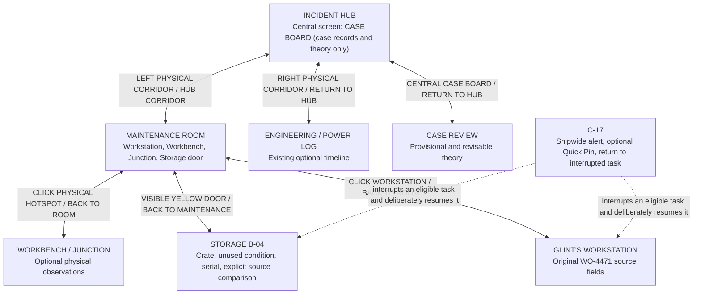

# VOID-EAGER — Physical Navigation & Hub Case Board Correction

**Date:** 30 October 2026
**Status:** IMPLEMENTED AND BROWSER-TESTED on `omnissiah`. This is a user-directed navigation correction after trying the game, not a new story branch.

## User feedback that motivated this pass

> Navigation is confusing. The things on the Workstation screen feel like they belong on the Hub screen. Why do you enter the Maintenance Room through a menu on the Hub computer rather than through the physical left/right corridors?

Actual issue reproduced: the Hub artwork depicts a Maintenance corridor on the left and an Engineering corridor on the right, **but neither corridor was clickable**. The central Hub computer instead offered direct room teleport buttons (`WORKSTATION`, `STORAGE B-04`, `POWER LOG`). The Workstation's auxiliary display also looked like a navigation menu despite having no interactive function. The Junction hotspot in Maintenance included part of the yellow door.

## New canonical room graph

**First opening is unchanged:** the one-time Case Brief appears in Maintenance. The player may start at the nearby Workstation or explore the room; the top-left `HUB CORRIDOR` button returns to the Hub.

**Movement rules:**
- The Hub's left corridor is the **only Hub → Maintenance** navigation target. It opens the **Maintenance room**, never jumps directly into Workstation focus.
- The Hub's right corridor enters **Engineering / optional Power Log**. The game currently has an Engineering console screen, not a separate Engineering room artwork. Power returns to the Hub.
- The **yellow door on the right side of Maintenance** opens Storage B-04. Its click region was separated from the Junction wall equipment hotspot.
- Storage's exit is `← MAINTENANCE`, returning to the physical room. The player then uses `← HUB CORRIDOR` to reach the Hub.
- Clicking the Workstation's central desk opens Glint's own Workstation. The original Work Order sections and their observation guards remain here; the Workstation is a **source terminal**, not the ship map.
- The Hub's middle display is **CASE BOARD ONLY**: observed-source index, comparison/C-17 status, provisional Theory/Revise Theory and End Session when permitted. No room-travel buttons.
- The HUD's Storage lead is **an informational route reminder**, not a disguised instant teleport. Source fact/recovery semantics remain as in P0-A/B/C.
- Quick Pin's explicit `RESUME TASK` action remains a deliberate context-recovery shortcut to its saved task; it is not ordinary location navigation.

## Visual and accessibility decisions

- Two large, keyboard/touch-operable Hub corridor hit areas are aligned with the actual left and right painted corridors; each has a persistent, legible label so travel does not require hover discovery.
- The Maintenance yellow door has an equally persistent amber label; the Junction reticle now targets the electrical panel instead of the doorway.
- The central case display shows only actually inspected source labels from `evidenceCatalog`, at most two newest observations plus a count. It never unlocks access to unobserved Work Order facts.
- The Workstation's auxiliary left monitor was changed from fake `WORK ORDERS / DIAGNOSTICS / PARTS TRACE / SERVICE CACHE` menu options to a read-only local terminal identification panel.
- No images or character backgrounds were replaced. The existing 16:9 scene artwork is maintained.

## Modified code and tests

- `src/components/HubScene.tsx`: remove teleport-menu controls; physically clickable left/right corridor overlays and source-only Case Board.
- `src/components/MaintenanceScene.tsx`, `src/components/MaintenanceRoomScene.tsx`, `src/content/maintenanceAssets.ts`, `src/components/WorldAssetHotspot.tsx`: new yellow Storage exit hotspot with separated Junction bounds; `← HUB CORRIDOR`.
- `src/components/StorageScene.tsx`: back to Maintenance instead of jumping straight to Hub.
- `src/components/WorkstationFocusScene.tsx`: noninteractive auxiliary monitor now clearly local/read-only.
- `src/components/StatusRail.tsx`: Storage lead becomes route hint rather than teleport button; Hub context is CASE BOARD.
- `src/app/GameApp.tsx`: physical route transitions, Case Board observed-source props, Storage back/recheck route.
- `src/game/objectives.ts`: navigation hints use corridors and the yellow door, not central-screen navigation or HUD teleport.
- `src/styles.css`: visual portal labels/hit areas, central case board and read-only lead style.
- `tests/physical_nav.py` (new): shared visible-door navigation helpers for browser tests.
- `tests/g4_physical_navigation.py` (new): direct physical-route, nonoverlap, case-source confidentiality, touch and all-size browser tests.
- Existing P0-A/P0-B/P0-C/G0–G3 tests updated to follow the new physical route, **not to weaken underlying evidence or interruption assertions**.

## Verified results

| Automated check | Result |
|---|---|
| New physical navigation test, 1024×576 / 1280×720 / 1464×815 / 1920×1080 | **4/4 PASS** |
| Both Hub doors, Storage yellow door, return path, bounds nonoverlap | PASS |
| No room teleport actions on central case screen | PASS |
| Case Board shows observed sources only, including Storage-first | PASS |
| Touch portal labels and tap | PASS |
| P0-A field/Storage navigation smoke | **5/5 PASS** |
| P0-A full Pin/no-Pin Loop 1 and Hub layout | **6/6 PASS** |
| P0-B interruption/recovery | **7/7 PASS** |
| P0-B scroll/once/remote console edges | PASS |
| P0-C observed-source comparison and revisions | **10/10 PASS** |
| G0–G3 visual layout, four sizes plus keyboard/touch | **4/4 PASS** |
| `npm run build` / `git diff --check` | PASS |

Visual review screenshots: `D:\_work\yoko\VOID-EAGER-navigation-qa` (outside the repository). Tested before and after the change, including the Hub with no evidence and with both Maintenance/Storage sources, Maintenance's separated Junction/Storage click targets, and the Workstation local terminal.

## Still outstanding

This correction **does not mean all G4–G6 visual cleanup is finished**. The Workstation focus/intention selector still grows inside its monitor and needs compaction, and the bottom HUD and Pin presentation can be less dense. P0-D interactive Reflection also remains. The Engineering corridor currently opens the **existing optional Power Log view**, not a newly illustrated Engineering room. The first-time starting room is still Maintenance. These are deliberate scope choices, not unnoticed omissions.

This user-tested navigation graph **supersedes the older Hub teleport-console behavior in `docs/26-LOOP1-UI-MOCK-LAYOUT-SPEC.md`**; evidence and interruption source behavior in P0-A/B/C remains canonical.
