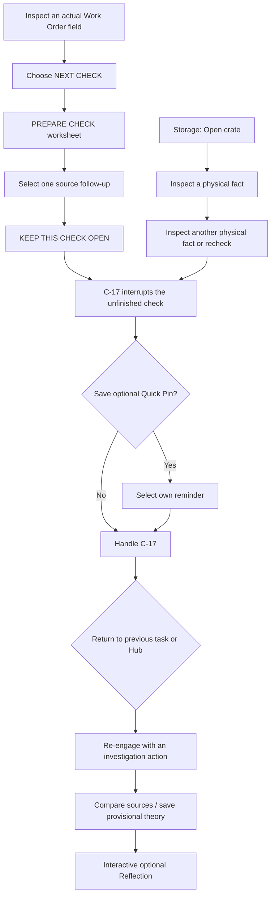

# VOID-EAGER — Active Interruption, Small-Screen HUD Fixes, Interactive Reflection

**Date:** 30 October 2026
**Status:** Implemented, browser-tested on `omnissiah`, and ready for first-time human playtesting.
**Scope:** Existing Loop 1 only. No new rooms, characters, evidence facts, AI, or diagnosis/scoring.

**Replaces:** The automatic `~7-second` C-17 trigger described in older P0-B and design documents. The player-selected focus is still required at Workstation, but **idle time alone no longer triggers the alert**. This change responds to the follow-up independent playtest in [34-POSTFIX-EXPLORATORY-PLAYTEST.md](34-POSTFIX-EXPLORATORY-PLAYTEST.md).

## 1. The new serious-game sequence

**Workstation:** Inspect an actual source field; choose a focus from the permanently visible NEXT CHECK menu; click PREPARE CHECK; in a separate neutral verification worksheet choose which already-available source to follow up. Options only reflect Work Order fields the player has inspected: re-read completion, trace the issued part to Storage B-04, or look for installation verification. Clicking KEEP THIS CHECK OPEN leaves a visible task marker on the Workstation and schedules a single C-17 prompt after a short transition. No correct-answer grading. The interrupted follow-up remains visible after handling the alert.

**Storage-first:** Opening a crate or inspecting the first physical fact **does not** trigger C-17. The player can choose physical condition or serial in either order; the second deliberate inspection (including a recheck) schedules C-17 after its evidence modal closes. A large passive wait does not create the alert. Both physical sources and the crate-open state persist.

**Safety and continuity:** C-17 still fires **once per run**, at a safe non-modal point. It remains pending across navigation, can be minimized, permits the player to choose or skip Quick Pin, accepts all three coolant classifications without grading, and returns to the captured previous task or Hub. The reducer rejects synthetic alerts not sourced from a real task. End Session still requires a saved theory, actual interrupted work, resolved C-17, and at least one post-C-17 investigation action; walking through a doorway does not count as context recovery.

**Quick Pin fidelity:** The saved Workstation cue now prioritizes the player's actual unfinished verification plan, using previously inspected source information only. Duplicate cue labels are removed. Saving a Pin alone still does not count as reviewing or using it.

## 2. UI corrections

- **Storage B-04:** The crate's OPEN CRATE cue is displayed above the bottom HUD at 1024×576 and 1280×720; the crate art remains clickable. The player may still inspect condition or serial in either order. No artwork replaced.
- **Workstation:** NEXT CHECK and PREPARE CHECK are visible together. The optional SAVE B-04 LEAD action remains independently available after selecting a focus, and is a wayfinding reminder—not a teleport.
- **Reflection:** The Restart button is always in a visible, fixed footer above the HUD at 1024×576 and the other three test sizes. The summary and three questions scroll within the panel, with explicit text telling players they may scroll for more or skip.
- **Opening orientation:** One concise Case Brief line identifies the starting location as Maintenance, the Hub via the upper-left exit, and Storage B-04 via the yellow right-side door. Workbench/Junction remain optional.

## 3. P0-D — Optional interactive Reflection

The ending now accepts three neutral, independent answers:

1. **Return difficulty:** Little effort / Some effort / A lot of effort / Not sure or prefer not to say.
2. **Support for resuming:** Reading my Quick Pin / Rechecking a source / Remembering without a note / Another approach / Not sure or prefer not to say.
3. **Effect on approach:** Yes / No / Not sure or prefer not to say.

All questions are **optional**; the player may answer any subset, SAVE REFLECTION, SKIP QUESTIONS, change an answer, or RESTART PROTOTYPE. `reflectionAnswers` and `reflectionSubmitted` live **only in local in-memory game state** and reset on restart; no network submission, persistence, correctness score, ASD diagnosis, or medical interpretation is added. The existing factual process summary (interruption, Quick Pin viewed, first activity after switching, evidence and case theory) remains intact.

## 4. Technical files changed

- `src/game/types.ts` and `src/game/state.ts`: `VerificationNextStep`, `interruptionReady`, player-selected follow-up, neutral Reflection state/actions and once-only alert validation.
- `src/app/GameApp.tsx`: removes the passive 7-second timer; defers a scripted C-17 until after purposeful Workstation/Storage action and modal close; passes source follow-up and reflection handlers.
- `src/components/WorkstationFocusScene.tsx`: PREPARE CHECK worksheet, explicit follow-up radio choices, persistent unfinished-check cue.
- `src/components/ReflectionScene.tsx`: optional accessible radio choices and Save/Skip/Restart fixed footer.
- `src/components/CaseBriefDialog.tsx`: one-line spatial orientation.
- `src/styles.css`: Storage label safe area, worksheet controls, responsive Workstation row, Reflection form and fixed footer.
- `tests/active_work.py`: shared test helper to perform purposeful work instead of waiting for a timer.
- `tests/p0d_active_reflection.py`: new seven-scenario scripted-interruption, Reflection and viewport suite.
- Older `tests/p0a_loop_regression.py`, `tests/p0b_interruption_recovery.py`, `tests/p0b_edge_regression.py`, `tests/p0b_ux_completion_gate.py` updated to use deliberate investigations, not the removed idle timer. All other existing tests retained.

## 5. Verification

| Test | Result |
|---|---|
| New active Workstation without idle alert; incomplete planned check; player-chosen Pin | **PASS** |
| Storage-first second-inspection trigger and deferred modal delivery | **PASS** |
| Reflection answer → save → skip → restart | **PASS** |
| Small-screen labels, source-check modal/button, footer and Restart fit at 1024×576 | **PASS** |
| Same fit at 1280×720, 1464×815, 1920×1080 | **PASS** |
| New `p0d_active_reflection.py` | **7/7** |
| P0-A navigation and complete Loop 1 (Pin/no Pin) | **5/5 + 6/6** |
| P0-B interruption/recovery and prior UX completion gate | **7/7 + 8/8** |
| P0-B scroll restoration and remote Storage C-17 console | **PASS** |
| P0-C observed sources and theory revision | **10/10** |
| G0–G3 and G4 screen/navigation/touch suites | **PASS at four sizes** |
| Fresh unaccelerated wall-clock Workstation path through Reflection | **PASS at 1024×576 and 1464×815**, C-17 ~0.8 s after source-plan action |
| `npm run build` and staged diff checks | **PASS** |

Artifacts for detailed visual QA live **outside the repository** in `D:\_work\yoko\VOID-EAGER-phase35-qa`.

## 6. What still needs human testing

**This is not a clinical efficacy test and not a first-time human participant playtest.** A novice may still find the verification worksheet too explicit or may prefer the interruption during a longer source-comparison activity. Observe a few unfamiliar players navigating without guidance, choosing a source, using or skipping Quick Pin, and finding all three Reflection prompts. Continue only with targeted changes based on observed friction.

**Remaining out of scope:** additional HUD polishing beyond the two verified blockers, fully illustrated Engineering room, additional characters/story branches, and formal research data collection. These must not be implied to be complete.
